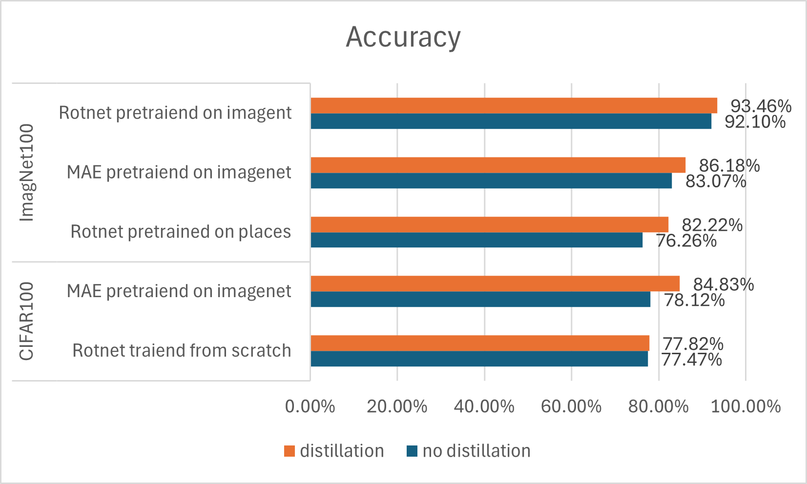
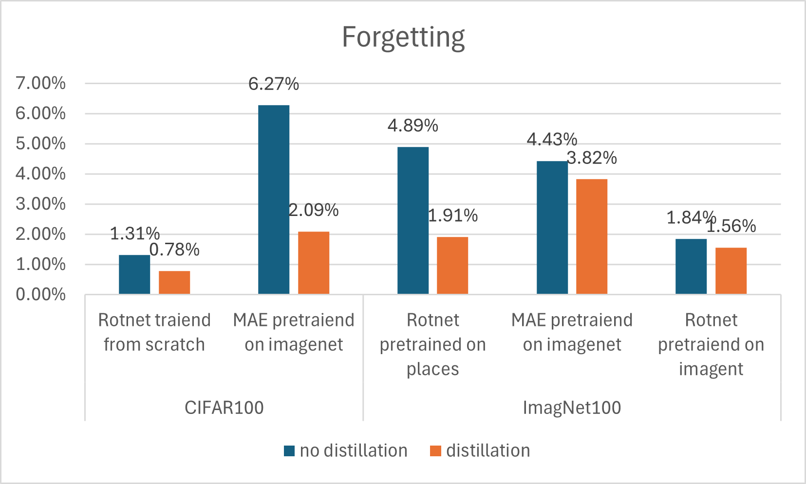

# Continual Self-Supervised Learning with Distillation (CaSSLe-inspired)

## Overview
This project explores continual self-supervised learning using MAE and RotNet backbones.  
The focus is on studying **knowledge distillation** to reduce forgetting and improve stability across tasks.  

Datasets: CIFAR-100, ImageNet subsets  
Models: RotNet, MAE  
Pretraining: None / ImageNet / Places  

## Acknowledgment
This project is inspired by **Self-Supervised Models are Continual Learners**.  
The core idea of using self-distillation to mitigate catastrophic forgetting motivated this work.

Original paper:  
[Self-Supervised Models are Continual Learners](https://arxiv.org/pdf/2112.04215)

> Note: This is **not an official implementation**. It explores similar ideas using different architectures, datasets, and training setups.

## Pipeline

**MAE**  

**RotNet**  

## Method
- Train MAE and RotNet models on continual learning tasks  
- Compare **distillation vs no distillation**  
- Evaluate using **average accuracy** and **forgetting metrics**  
- Analyze the effect of pretraining (ImageNet / Places)  

### Plots

**Accuracy Comparison**  

**Forgetting Comparison**  

## Key Observations
The experiments highlight that RotNet is a highly promising SSL backbone for continual learning. On CIFAR-100, it shows very low forgetting even without distillation, and on ImageNet-100, CASSEL distillation further improves stability. MAE, while benefiting from distillation, is more prone to forgetting due to its transformer-based architecture. These results suggest that simpler CNN-based SSL models can be highly effective for continual learning, providing a strong baseline and lower computational requirements than transformer-based models. 

